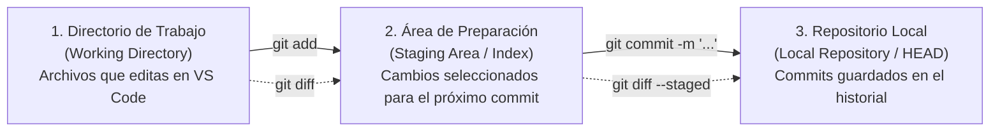

# 02 — Añadir Cambios, Crear Commits y Comparar

En Git, guardar un archivo en el editor de código (como VS Code) **no** crea automáticamente un punto en el historial. Git separa el proceso en tres espacios distintos para darte control total sobre qué cambios agrupas y cómo los documentas.

---

## 1. Las Tres Áreas de Git: Modificar vs. Preparar vs. Registrar



1. **Modificar archivos (Directorio de trabajo):** Editas `index.html` o `css/pages/index.css` y guardas en tu editor. Git detecta que el archivo fue modificado (`Changes not staged for commit`), pero aún no forma parte del próximo commit.
2. **Preparar cambios (*Staging Area* con `git add`):** Eliges qué archivos modificados quieres incluir en la próxima fotografía del proyecto. Esto te permite, por ejemplo, haber tocado tres archivos pero preparar primero solo uno para crear un commit específico y ordenado.
3. **Registrar en un commit (Repositorio local con `git commit`):** Tomas todos los cambios que estaban en el área de preparación y los guardas permanentemente en el historial local de tu rama con un identificador único (hash SHA-1, como `dfb3623`), autor, fecha y mensaje descriptivo.

---

## 2. Comandos para Preparar y Confirmar Cambios

### `git add archivo`
- **Qué hace:** Toma el estado actual de un archivo específico (por ejemplo, `git add index.html` o `git add css/pages/index.css`) y lo coloca en el área de preparación (*Staging Area*).
- **Por qué existe:** Permite preparar cambios con precisión quirúrgica, evitando incluir por accidente otros archivos que aún estén a medio terminar o archivos temporales.
- **Cuándo se utiliza:** Es la **forma recomendada** durante toda la práctica cada vez que termines una tarea concreta.
- **Ejemplo:**
  ```bash
  git add index.html
  git status
  ```
- **Resultado que produce:** El archivo pasa de la sección roja (`Changes not staged for commit`) a la sección verde (`Changes to be committed`) en `git status`.
- **Riesgos:** Bajo. Si agregaste el archivo equivocado, puedes sacarlo del área de preparación sin perder tus cambios usando `git restore --staged archivo`.

---

### `git add .`
- **Qué hace:** Añade al área de preparación **todos** los archivos modificados y archivos nuevos sin seguimiento (*untracked*) desde la carpeta actual hacia adentro.
- **Por qué existe:** Es un atajo rápido cuando estás 100% segura de que todos los archivos modificados o creados en el proyecto pertenecen al mismo commit lógico.
- **Cuándo se utiliza:** Solo después de haber ejecutado `git status` y `git diff` y haber comprobado que no hay ningún archivo basura, temporal o de otra tarea en tu directorio.
- **Resultado que produce:** Todos los cambios pendientes pasan en bloque al área de preparación.
- **Riesgos y precauciones:** **Moderado.** Si tenías un archivo de prueba, una imagen suelta o cambios de dos tareas distintas mezclados, `git add .` los meterá todos juntos en el mismo saco. Por eso en las tareas diarias priorizamos `git add ruta/del/archivo`.

---

### `git commit -m "mensaje"`
- **Qué hace:** Crea un nuevo commit en la rama actual con los cambios que se encuentran en el área de preparación, asignándole el texto indicado entre comillas como descripción.
- **Por qué existe:** Registra un punto de control permanente y auditable en la historia del proyecto.
- **Cuándo se utiliza:** Después de preparar los archivos con `git add` y verificar con `git diff --staged`.
- **Cómo escribir un buen mensaje:** Evita mensajes vagos como `"cambios"`, `"test"`, `"sexto"` o `"hola"`. Escribe en una frase clara qué hiciste y dónde:
  ```bash
  git commit -m "Corregir texto de garantía de devolución en index.html"
  ```
- **Resultado que produce:** Muestra el nombre de la rama, el hash corto del nuevo commit, el mensaje y un resumen de cuántos archivos e inserciones/eliminaciones se registraron.
- **Riesgos:** Ninguno si verificaste antes con `git diff --staged`. Si olvidaste hacer `git add`, Git no creará el commit y te avisará que no hay cambios preparados.

---

### `git commit --amend`
- **Qué hace:** Reemplaza el **último commit** de tu rama actual por un commit completamente nuevo (con un nuevo hash identificador). Permite corregir el mensaje del último commit o agregarle archivos que olvidaste preparar con `git add`.
- **Por qué existe:** Es muy común hacer `git commit` y notar un segundo después que hubo un error tipográfico en el mensaje o que faltó guardar una línea en el mismo archivo.
- **Cuándo se utiliza:**
  - **Para cambiar solo el mensaje del último commit (sin haber hecho `git add` de nada nuevo):**
    ```bash
    git commit --amend -m "Mensaje corregido y más claro"
    ```
  - **Para incluir un archivo olvidado en el último commit:**
    ```bash
    git add archivo-olvidado.css
    git commit --amend -m "Actualizar estilos de inicio y tarjeta"
    ```
- **Resultado que produce:** El commit anterior deja de estar en la punta de tu rama y es sustituido por el nuevo commit corregido.
- **⚠️ ADVERTENCIA DE RIESGO IMPORTANTE:**
  - `git commit --amend` **reescribe el historial** porque destruye la referencia al commit anterior y crea otro con distinto código hash.
  - **REGLA ESTRICTA:** Úsalo **únicamente en commits locales que todavía NO has subido a GitHub con `git push`**. Si ya publicaste el commit y tu compañera ya descargó tu rama, usar `--amend` hará que las historias diverjan y provocará rechazos al intentar subir cambios. Si ya hiciste `git push`, no uses `--amend`: crea simplemente un segundo commit normal.

---

## 3. Comandos para Inspeccionar los Commits Creados

### `git log --oneline`
- **Qué hace:** Muestra la lista de commits de la rama actual desde el más reciente hacia atrás, resumiendo cada commit en una sola línea (hash corto de 7 caracteres + referencias de rama + mensaje del commit).
- **Por qué existe:** El comando `git log` completo ocupa muchas líneas por cada commit; `--oneline` permite ver de un vistazo la secuencia de trabajo reciente.
- **Cuándo se utiliza:** Después de crear un commit, al cambiar de rama o al revisar qué commits trajo una compañera. Puedes limitar la cantidad de líneas añadiendo `-n 5` (por ejemplo: `git log --oneline -n 5`).
- **Resultado que produce:**
  ```text
  dfb3623 (HEAD -> main, origin/main, origin/HEAD) test
  eee6b72 (origin/adrix) sexto
  13e7210 quinto
  ```
- **Riesgos:** Ninguno (solo lectura). Si la lista es larga, pulsa `q` para volver a escribir en la terminal.

---

### `git show`
- **Qué hace:** Muestra toda la información detallada de un commit específico: su autor, fecha, mensaje completo y el `diff` exacto de todas las líneas modificadas en ese commit. Si no indicas ningún hash (`git show` a secas), muestra el último commit (`HEAD`).
- **Por qué existe:** Permite inspeccionar qué se guardó realmente dentro de un commit ya creado, tanto el tuyo como el de tu compañera.
- **Cuándo se utiliza:**
  - Justo después de ejecutar `git commit`, para confirmar que el commit quedó perfecto.
  - Durante el rol de **Revisora**, para inspeccionar commit por commit lo que hizo tu compañera (`git show <hash>`).
- **Ejemplo:**
  ```bash
  # Ver el último commit de la rama actual:
  git show

  # Ver un commit específico por su hash:
  git show dfb3623
  ```
- **Riesgos:** Ninguno (solo lectura). Pulsa `q` para salir del visor.

