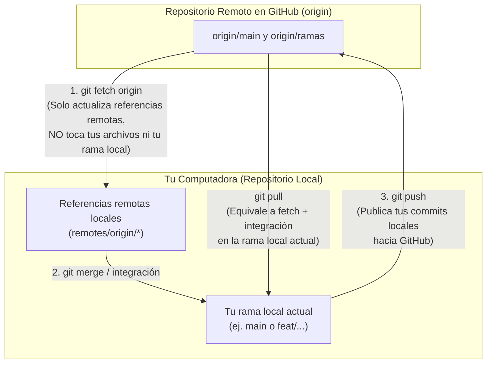

# 05 — Diferencia entre `fetch`, `pull` y `push`

Comprender qué ocurre exactamente cuando tu repositorio local se comunica con GitHub (`origin`) es la base para trabajar en equipo sin sobrescribir ni perder cambios.

---

## 1. Resumen Conceptual: ¿Qué Hace Cada Uno?



- **`git fetch`:** Consulta el servidor `origin`, descarga los commits y ramas nuevos que existan allí y actualiza tus referencias remotas (`origin/main`, `origin/rama-compañera`), **pero NO modifica tu rama local actual ni cambia tus archivos de trabajo**. Es 100% seguro para inspeccionar antes de integrar.
- **`git pull`:** Obtiene las actualizaciones desde el remoto y **actuando de inmediato integra esos cambios** dentro de la rama local en la que estés situada (según la configuración del repositorio y las opciones que pases, mediante *merge* o *rebase*).
- **`git push`:** Envía y publica los commits que registraste en tu rama local hacia el repositorio remoto en GitHub (`origin`).

---

## 2. Explicación Individual de Cada Comando

### `git fetch origin`
- **Propósito:**Conectarse al remoto `origin` y descargar las actualizaciones de todas las ramas configuradas en el *refspec* estándar del repositorio (`+refs/heads/*:refs/remotes/origin/*`).
- **Qué referencias o ramas afecta:** Actualiza las referencias de seguimiento remoto bajo `remotes/origin/*` (las que ves con `git branch -r`). **No altera** ninguna rama local (`main`, etc.) ni toca los archivos abiertos en tu editor.
- **Cuándo se utiliza:**
  - Antes de revisar la rama que tu compañera acaba de publicar en GitHub.
  - Cuando quieres comprobar si `origin/main` tiene commits nuevos antes de decidir cómo integrarlos.
- **Precauciones:** Ninguna; es una operación segura que nunca genera conflictos de fusión por sí misma.

---

### `git fetch origin main`
- **Propósito:** Conectarse a `origin` y descargar **únicamente** los nuevos objetos y el estado de la rama `main` del servidor.
- **Qué referencias o ramas afecta:**
  - Actualiza `FETCH_HEAD` y, en versiones modernas de Git con la configuración estándar del remoto `origin`, actualiza la referencia remota `origin/main`.
  - **Aclaración fundamental:** `git fetch origin main` **NO descarga ni actualiza el resto de ramas remotas** que tu compañera haya creado en GitHub (por ejemplo, si Jamile subió `feat/jamile-dia02-header`, ejecutar `git fetch origin main` **no** traerá esa rama a tu `git branch -r`).
- **Cuándo se utiliza:** Cuando solo te interesa consultar si hubo cambios en `main` en el servidor y no necesitas traer el resto de ramas remotas.
- **Precauciones:** Recuerda que, al ser un `fetch`, tampoco modifica los archivos de tu rama local `main` hasta que los integres con `merge` o `pull`. Para ver todas las ramas nuevas de tu compañera, usa `git fetch origin` (sin limitar a `main`).

---

### `git pull`
- **Propósito:** Descargar los cambios desde la rama remota configurada como *upstream* (seguimiento) de tu rama actual e integrarlos inmediatamente en tu rama local.
- **Qué referencias o ramas afecta:** Actualiza las referencias remotas del servidor y modifica directamente **la rama local en la que estés situada** y los archivos de tu directorio de trabajo.
- **Cuándo se utiliza:** Cuando estás en una rama que ya tiene configurada su rama de seguimiento remota (por ejemplo, `main` siguiendo a `origin/main`) y deseas actualizarla en un solo paso.
- **Precauciones:**
  - Si no sabes en qué rama estás parada, o si hiciste commits locales en `main` que divergen de `origin/main`, un `git pull` sin opciones puede crear un commit de fusión automático o abrir un conflicto inesperado.
  - Nunca ejecutes `git pull` con cambios sin confirmar que choquen con los archivos que vienen del servidor.

---

### `git pull origin main`
- **Propósito:** Descargar explícitamente los cambios de la rama `main` del remoto `origin` e integrarlos en **la rama local donde estés situada en ese instante**.
- **Qué referencias o ramas afecta:** Actualiza `origin/main` y fusiona esos cambios dentro de tu rama local activa (`HEAD`).
- **Cuándo se utiliza:**
  - Estando parada en `main` (`git switch main`), para traer los últimos cambios integrados en GitHub.
  - Estando parada en tu rama de tarea, si deseas traer hacia tu rama de tarea los cambios recientes que ya se integraron en `origin/main`.
- **Precauciones:** Verifica siempre con `git status` o `git branch` en qué rama estás antes de ejecutar `git pull origin main`, porque integrará `main` dentro de la rama donde te encuentres parada.

---

### `git pull --ff-only origin main`
- **Propósito:** Actualizar tu rama local desde `origin/main` **permitiendo únicamente un avance rápido (*fast-forward*)**.
- **Qué significa `--ff-only`:** Un avance rápido ocurre cuando tu rama local no tiene commits propios divergentes respecto a `origin/main`, por lo que Git simplemente desliza el puntero de tu rama hacia adelante hasta alcanzar a `origin/main` sin crear commits de fusión adicionales. Si tu rama local tuviera commits divergentes y no fuera posible avanzar en línea recta, **el comando se detiene y falla de forma segura** sin tocar nada.
- **Qué referencias o ramas afecta:** Actualiza `origin/main` y avanza limpiamente tu rama `main` local.
- **Cuándo se utiliza:** Es la **forma más segura y recomendada** en esta práctica para actualizar tu rama `main` local antes de empezar una tarea o antes de integrar la rama de tu compañera.
- **Precauciones:** Si falla indicando `fatal: Not possible to fast-forward, aborting`, significa que hiciste algún commit directamente en tu `main` local que no está en el servidor. No fuerces nada: inspecciona con `git log --oneline --graph --all`.

---

### `git push origin nombre-rama`
- **Propósito:** Publicar los commits de tu rama local `nombre-rama` en una rama del mismo nombre dentro del repositorio remoto `origin` (GitHub).
- **Qué referencias o ramas afecta:** Crea o actualiza la rama `nombre-rama` en el servidor de GitHub y tu referencia `origin/nombre-rama`.
- **Cuándo se utiliza:** Cuando ya terminaste y verificaste tus commits en tu rama de trabajo y quieres subirlos a GitHub.
- **Precauciones:** A diferencia de `git push -u origin nombre-rama`, no deja guardado el vínculo de seguimiento (*upstream*) si es la primera vez que subes esa rama.

---

### `git push -u origin nombre-rama`
- **Propósito:** Publica tu rama local `nombre-rama` en GitHub (`origin`) **y además establece con `-u` (`--set-upstream`) la relación de seguimiento permanente** entre tu rama local `nombre-rama` y `origin/nombre-rama`.
- **Qué referencias o ramas afecta:** Crea/actualiza la rama en GitHub, actualiza `origin/nombre-rama` y guarda en `.git/config` que tu rama local sigue a `origin/nombre-rama`.
- **Cuándo se utiliza:** **La primera vez** que publicas una rama nueva que acabas de crear localmente con `git switch -c nombre-rama`. Gracias a `-u`, a partir de ese momento `git status` te informará si estás al día con tu rama remota, y en futuros envíos dentro de esa misma rama podrás escribir simplemente `git push` o `git push origin nombre-rama`.
- **Resultado que produce:**
  ```text
  To https://github.com/SaraviaH/conflictos-test.git
   * [new branch]      feat/adriana-dia01-inicio -> feat/adriana-dia01-inicio
  branch 'feat/adriana-dia01-inicio' set up to track 'origin/feat/adriana-dia01-inicio'.
  ```

---

### `git push origin main`
- **Propósito:** Publicar en GitHub los commits nuevos que se han integrado en tu rama local `main`.
- **Qué referencias o ramas afecta:** Actualiza la rama principal `main` en el servidor de GitHub (`origin/main`) para que esté disponible para todo el equipo.
- **Cuándo se utiliza:** **Únicamente en el rol de Integradora**, después de haber revisado y probado la rama de tu compañera, haber actualizado tu `main` local y haber ejecutado `git merge` sin errores.
- **Precauciones:** Nunca hagas `git push origin main` sin haber verificado antes con `git log --oneline -n 5` y `git status` qué commits estás a punto de publicar en la rama principal del proyecto.

---

### `git push --force-with-lease`
- **Propósito:** Forzar la actualización de una rama remota reemplazando el historial que hay en el servidor por el historial de tu rama local, **pero con una comprobación de seguridad**: verifica primero que nadie más haya subido un commit nuevo a esa rama remota desde la última vez que hiciste `git fetch`. Si alguien más subió algo que tú no tienes visto en tu referencia remota, aborta el envío.
- **Por qué existe:** En flujos avanzados donde una desarrolladora reescribe intencionalmente su propia rama de trabajo personal (por ejemplo, con `commit --amend` o `rebase`), un `git push` normal será rechazado porque la historia cambió. `--force-with-lease` es una alternativa menos ciega que `--force`.
- **⚠️ ADVERTENCIA DE RIESGO IMPORTANTE:**
  - Aunque sea más seguro que `--force`, **`git push --force-with-lease` reescribe el historial remoto y puede eliminar commits del servidor**.
  - **NUNCA debe utilizarse sobre `main`**.
  - **NUNCA debe utilizarse como respuesta automática** cuando Git rechaza un `git push` con el mensaje `Updates were rejected because the remote contains work that you do not have locally`. Cuando aparece ese mensaje en el trabajo diario, lo correcto es hacer `git fetch` y `git pull`, no forzar el envío.

