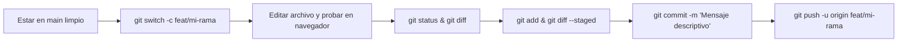
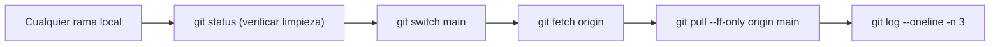
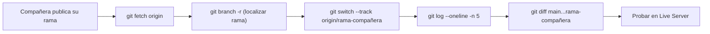
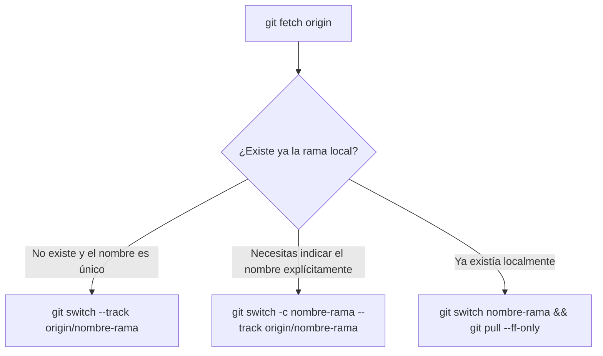
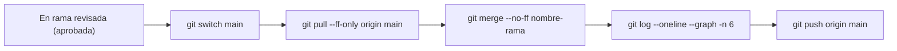
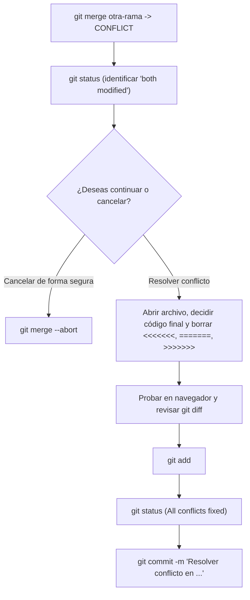
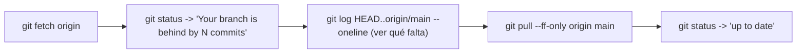
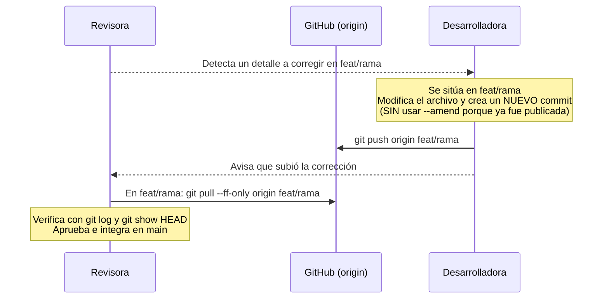
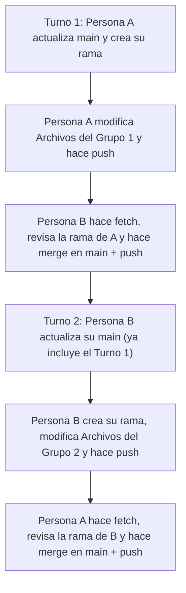
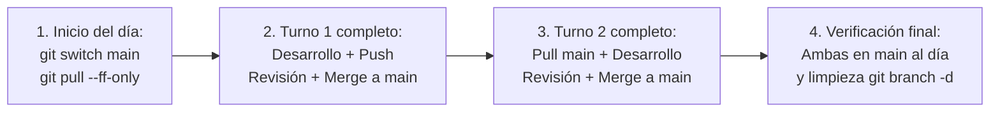

# 09 — Flujos Completos de Trabajo (10 Escenarios con Diagramas)

En este documento se detallan los **10 procedimientos completos** que Adriana y Jamile ejecutarán durante su práctica. Para cada flujo se indica:
- Desde qué rama se empieza.
- Qué comandos exactos deben ejecutarse.
- Qué resultado se espera.
- Cómo comprobar que el paso funcionó.
- Qué hacer si falla.

---

## Flujo 1: Crear una rama, modificar archivos, crear un commit y subirla



- **Rama inicial:** `main` (previamente actualizada y con directorio de trabajo limpio).
- **Comandos a ejecutar:**
  ```bash
  git status
  git switch -c feat/adriana-dia01-inicio
  # (Realizar modificaciones en el editor y verificar en Live Server)
  git status
  git diff
  git add index.html
  git diff --staged
  git commit -m "Corregir texto de garantía de satisfacción en index.html"
  git push -u origin feat/adriana-dia01-inicio
  ```
- **Resultado esperado:** Se crea la rama local, se registra el commit y se publica la rama en GitHub vinculada mediante seguimiento (`-u`).
- **Cómo comprobar que funcionó:**
  - `git status` muestra `On branch feat/adriana-dia01-inicio` y `Your branch is up to date with 'origin/feat/adriana-dia01-inicio'`.
  - `git log --oneline -n 2` muestra el nuevo commit en la punta de la rama.
- **Qué hacer si falla:**
  - Si `git switch -c` dice `fatal: a branch named '...' already exists`, verifica con `git branch` si ya la habías creado antes y cámbiate con `git switch feat/adriana-dia01-inicio`.
  - Si `git commit` dice `nothing added to commit`, verifica con `git status` la ruta exacta del archivo y ejecuta `git add <ruta>` antes de repetir el commit.

---

## Flujo 2: Descargar el `main` más reciente antes de empezar una tarea



- **Rama inicial:** Cualquier rama en la que hayas quedado tras la tarea anterior, o `main`.
- **Comandos a ejecutar:**
  ```bash
  git status
  git switch main
  git fetch origin
  git pull --ff-only origin main
  git log --oneline -n 3
  ```
- **Resultado esperado:** Tu rama `main` local avanza limpiamente (*fast-forward*) hasta coincidir con el último commit de `origin/main`.
- **Cómo comprobar que funcionó:**
  - `git status` indica `On branch main` y `Your branch is up to date with 'origin/main'`.
  - En `git log --oneline -n 3`, los hashes de `HEAD -> main` y `origin/main` apuntan exactamente al mismo commit.
- **Qué hacer si falla:**
  - Si no te deja cambiar a `main` porque tienes cambios sin confirmar, guárdalos en tu rama de trabajo (commit) o usa `git stash push -m "pendiente"`.
  - Si `git pull --ff-only` falla con `Not possible to fast-forward`, significa que creaste un commit directamente en tu `main` local por error. Inspecciona con `git log --oneline --graph --decorate --all -n 8` antes de tomar acción.

---

## Flujo 3: Descargar y revisar la rama de una compañera



- **Rama inicial:** `main` (con `working tree clean`).
- **Comandos a ejecutar:**
  ```bash
  git status
  git fetch origin
  git branch -r
  git switch --track origin/feat/adriana-dia01-inicio
  git log --oneline -n 5
  git diff --name-status main...feat/adriana-dia01-inicio
  git diff main...feat/adriana-dia01-inicio
  git show
  ```
- **Resultado esperado:** Descargas la rama de tu compañera, inspeccionas sus commits y diferencias frente a `main`, y compruebas los cambios en el navegador.
- **Cómo comprobar que funcionó:**
  - `git branch` muestra `* feat/adriana-dia01-inicio`.
  - Al recargar `http://localhost:5500` ves los cambios hechos por tu compañera.
- **Qué hacer si falla:**
  - Si la rama no aparece en `git branch -r`, confirma que ejecutaste `git fetch origin` (sin limitar a otra rama) y pregunta a tu compañera si su `git push -u origin ...` terminó sin errores.

---

## Flujo 4: Crear una rama local de seguimiento con `git switch --track` (y su forma explícita con `-c`)



- **Rama inicial:** `main`.
- **Comandos a ejecutar:**
  ```bash
  git fetch origin
  # Opción estándar recomendada:
  git switch --track origin/feat/jamile-dia04-fragancias

  # Opción explícita equivalente (si necesitas declarar el nombre local):
  git switch -c feat/jamile-dia04-fragancias --track origin/feat/jamile-dia04-fragancias
  ```
- **Resultado esperado:** Se crea la rama local `feat/jamile-dia04-fragancias` configurada para seguir a `origin/feat/jamile-dia04-fragancias`.
- **Cómo comprobar que funcionó:**
  - Ejecuta `git branch -vv` y verifica que junto a `* feat/jamile-dia04-fragancias` aparezca entre corchetes `[origin/feat/jamile-dia04-fragancias]`.
- **Qué hacer si falla:**
  - Si devuelve `fatal: a branch named '...' already exists`, significa que ya habías creado esa rama local antes. En ese caso no uses `--track` ni `-c`: cámbiate con `git switch feat/jamile-dia04-fragancias` y actualízala con `git pull --ff-only`.

---

## Flujo 5: Fusionar una rama revisada e integrar el resultado en `main`



- **Rama inicial:** Empiezas cambiando desde la rama que acabas de revisar hacia `main` (`git switch main`).
- **Comandos a ejecutar:**
  ```bash
  git switch main
  git status
  git fetch origin
  git pull --ff-only origin main
  git merge --no-ff feat/adriana-dia01-inicio -m "Merge branch 'feat/adriana-dia01-inicio' into main"
  git log --oneline --graph --decorate -n 6
  git push origin main
  ```
- **Resultado esperado:** Los cambios de la rama revisada quedan integrados en `main` local y publicados en `origin/main`.
- **Cómo comprobar que funcionó:**
  - `git status` muestra `On branch main` y `Your branch is up to date with 'origin/main'`.
  - El sitio abierto en `main` muestra las mejoras recién integradas.
- **Qué hacer si falla:**
  - Si durante el `merge` surge un conflicto inesperado y aún no sabes cómo resolverlo, ejecuta `git merge --abort` y aplica el Flujo 6.

---

## Flujo 6: Resolver un conflicto de fusión



- **Rama inicial:** La rama donde ejecutaste `git merge` (por ejemplo, `main` al integrar una rama, o tu rama al traer `main`).
- **Comandos a ejecutar:**
  ```bash
  # Tras aparecer el mensaje CONFLICT:
  git status
  # 1. Abrir el archivo marcado como 'both modified' en VS Code.
  # 2. Dejar el código final deseado y eliminar las líneas <<<<<<<, ======= y >>>>>>>.
  # 3. Guardar el archivo y comprobar en el navegador.
  git diff
  git add css/global/variables.css
  git status
  git commit -m "Resolver conflicto en variables.css e integrar cambios"
  ```
- **Resultado esperado:** La fusión se completa creando el commit de resolución sin dejar marcadores de conflicto en el código.
- **Cómo comprobar que funcionó:**
  - `git status` muestra `nothing to commit, working tree clean`.
  - `git log --oneline --graph -n 5` muestra el commit de unión con sus dos ramas madres.
- **Qué hacer si falla:**
  - Si te equivocas editando el archivo antes de hacer `git commit`, siempre puedes ejecutar `git merge --abort` para regresar al punto exacto previo al `merge` y volver a empezar con calma.

---

## Flujo 7: Recuperarse de una rama local atrasada



- **Rama inicial:** `main` (o la rama local que esté atrasada respecto a su remota).
- **Comandos a ejecutar:**
  ```bash
  git fetch origin
  git status
  # Ver qué commits nuevos hay en el servidor que aún no tienes:
  git log HEAD..origin/main --oneline
  # Actualizar mediante avance rápido:
  git pull --ff-only origin main
  git status
  ```
- **Resultado esperado:** Tu rama local incorpora los commits que tu compañera había subido a `origin/main` y queda al día.
- **Cómo comprobar que funcionó:**
  - `git status` dice `Your branch is up to date with 'origin/main'`.
- **Qué hacer si falla:**
  - Si tienes cambios locales sin guardar que impiden el `pull`, ejecuta primero `git stash push -m "temporal"`, luego `git pull --ff-only origin main` y finalmente `git stash pop`.

---

## Flujo 8: Corregir una rama que ya fue publicada y tiene cambios nuevos solicitados por la revisora



- **Rama inicial (Desarrolladora):** Su propia rama de tarea (`feat/adriana-dia07-envios`).
- **Comandos a ejecutar por la Desarrolladora:**
  ```bash
  git switch feat/adriana-dia07-envios
  git status
  # (Realizar la corrección solicitada en el archivo)
  git add css/pages/envios.css
  git commit -m "Ajustar borde continuo en iconos de políticas de envío"
  git push origin feat/adriana-dia07-envios
  ```
- **Comandos a ejecutar después por la Revisora:**
  ```bash
  git switch feat/adriana-dia07-envios
  git fetch origin
  git pull --ff-only origin feat/adriana-dia07-envios
  git show HEAD
  ```
- **Resultado esperado:** La rama publicada recibe el commit adicional limpio y la revisora lo descarga sin conflictos de historial.
- **Cómo comprobar que funcionó:** Ambas ven exactamente el mismo último commit en `git log --oneline -n 3`.
- **Qué hacer si falla:** Recuerda **no usar `git commit --amend`** cuando la rama ya fue publicada y descargada por tu compañera; añade siempre un commit nuevo normal.

---

## Flujo 9: Trabajar alternadamente entre Adriana y Jamile sin editar simultáneamente los mismos archivos



- **Rama inicial:** Ambas parten de `main` sincronizado con `origin/main`.
- **Comandos clave en el cambio de turno:**
  ```bash
  # Cuando termina el Turno 1 y se publicó en origin/main, quien inicia el Turno 2 ejecuta:
  git switch main
  git fetch origin
  git pull --ff-only origin main
  git switch -c feat/rama-turno-2
  ```
- **Resultado esperado:** Un historial lineal o de fusiones limpias donde cada turno parte del trabajo ya integrado del turno anterior, evitando choques accidentales.
- **Cómo comprobar que funcionó:** `git log --oneline --graph --decorate -n 10` muestra una secuencia ordenada de integraciones.
- **Qué hacer si falla:** Si la Persona B creó su rama del Turno 2 *antes* de que se integrara el Turno 1 en `main`, puede actualizar su rama trayendo `main` con `git fetch origin` y `git merge origin/main`.

---

## Flujo 10: Completar una jornada de práctica desde la actualización inicial hasta la verificación final



- **Rama inicial y final de la jornada:** `main`.
- **Comandos de cierre al terminar el día (ejecutados por ambas):**
  ```bash
  git switch main
  git fetch origin
  git pull --ff-only origin main
  git status
  git log --oneline --graph --decorate -n 8
  # Opcional: limpiar ramas locales del día que ya fueron fusionadas en main:
  git branch -d nombre-rama-turno-1 nombre-rama-turno-2
  ```
- **Resultado esperado:** Tanto Adriana como Jamile terminan el día en `main`, con el directorio de trabajo limpio (`working tree clean`), sincronizadas con `origin/main` y con la aplicación funcionando sin errores en el navegador.
- **Cómo comprobar que funcionó:** Ambas ejecutan `git rev-parse --short HEAD` en su rama `main` y obtienen exactamente el mismo código hash de 7 caracteres.
- **Qué hacer si falla:** Si `git branch -d` avisa que una rama no está fusionada (`is not fully merged`), no uses `-D`: revisa con `git log main..nombre-rama` qué commit faltó integrar en `main`.

