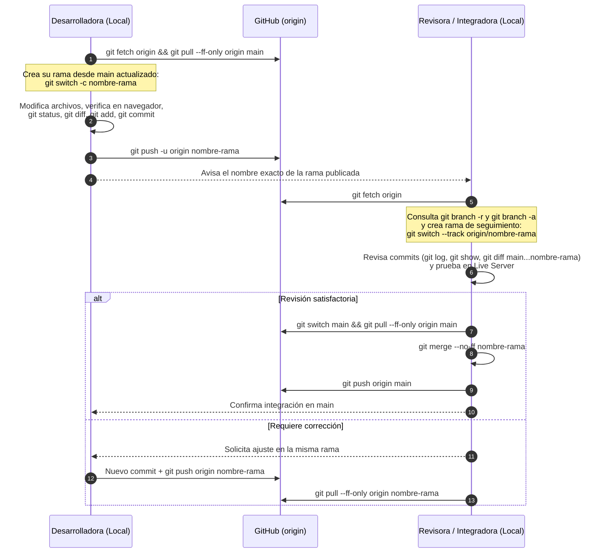

# Flujo de Trabajo Colaborativo entre Adriana y Jamile

Este documento define el protocolo exacto que **Adriana** y **Jamile** seguirán durante los 15 días de práctica. Ambas trabajan conectadas al mismo repositorio remoto configurado bajo el nombre `origin` (`https://github.com/SaraviaH/conflictos-test.git`).

> **Regla fundamental:** Solo una persona realiza modificaciones e integración de una tarea compartida a la vez. La otra persona espera la publicación de la rama para descargarla, revisarla e integrarla. **Nunca editen simultáneamente el mismo archivo para simular colaboración.**

---

## Vista General del Ciclo en Cada Turno



---

## Etapa A. Preparación de la Desarrolladora

Antes de escribir una sola línea de código, la desarrolladora debe asegurarse de que su directorio de trabajo esté limpio y que parte del `main` más reciente:

1. **Verificar la rama actual y cambios pendientes:**
   ```bash
   git status
   ```
   - Si existen cambios locales pendientes de otra tarea, **no actualices ni cambies de rama a ciegas**. Revísalos con `git diff` o guárdalos temporalmente con `git stash push -m "descripcion"`.

2. **Comprobar la conexión con el repositorio remoto:**
   ```bash
   git remote -v
   ```
   - Debe mostrar `origin  https://github.com/SaraviaH/conflictos-test.git` tanto para `(fetch)` como para `(push)`.

3. **Situarse en `main` y obtener los últimos cambios del servidor:**
   ```bash
   git switch main
   git fetch origin
   git pull --ff-only origin main
   ```
   - Verifica con `git log --oneline -n 3` que el último commit de `main` incluye el trabajo integrado en el turno o día anterior.

4. **Crear y cambiar a la nueva rama de trabajo:**
   ```bash
   git switch -c nombre-de-la-rama
   ```
   - Comprueba con `git branch` que el asterisco (`*`) señala tu nueva rama.

---

## Etapa B. Modificación y Publicación

La desarrolladora ejecuta las 2 o 3 tareas asignadas en su guía del día:

1. **Realizar los cambios y verificar en el navegador:**
   - Edita únicamente los archivos indicados en la tarea.
   - Abre el proyecto con **Live Server** y comprueba visualmente el resultado y la consola del navegador (F12).

2. **Inspeccionar las modificaciones realizadas antes de prepararlas:**
   ```bash
   git status
   git diff
   ```

3. **Añadir archivos al área de preparación (*Staging Area*) y verificar:**
   ```bash
   git add ruta/del/archivo
   git diff --staged
   ```
   - Preferir `git add ruta/del/archivo` sobre `git add .` para controlar exactamente qué entra en cada commit.

4. **Registrar commits descriptivos:**
   ```bash
   git commit -m " Verbo claro + qué se modificó y dónde"
   ```
   - Se recomienda crear un commit por cada tarea lógica (2 a 3 commits por rama) para facilitar la revisión de la compañera.

5. **Consultar el historial de la rama antes de subirla:**
   ```bash
   git log --oneline -n 5
   git show
   ```

6. **Publicar la rama en GitHub estableciendo seguimiento (*upstream*):**
   ```bash
   git push -u origin nombre-de-la-rama
   ```
   - Si después necesitas subir un segundo commit a esa misma rama, bastará con ejecutar `git push` o `git push origin nombre-de-la-rama`.

---

## Etapa C. Descarga y Revisión de la Compañera

Cuando la desarrolladora avisa que su rama ya está en GitHub, la **Revisora** realiza los siguientes pasos:

1. **Verificar que su propio directorio de trabajo está limpio:**
   ```bash
   git status
   ```

2. **Consultar las ramas antes de actualizar desde el servidor:**
   ```bash
   git branch
   git branch -r
   ```
   - Observa que la rama nueva de tu compañera **todavía no aparece** en `git branch -r` porque tu Git local aún no ha consultado a GitHub.

3. **Actualizar las referencias remotas con `git fetch`:**
   ```bash
   git fetch origin
   ```

4. **Volver a consultar las ramas remotas y todas las ramas:**
   ```bash
   git branch -r
   git branch -a
   ```
   - Ahora verás aparecer `origin/nombre-de-la-rama` en la lista de referencias remotas, mientras que en la lista de ramas locales todavía no existe.

5. **Crear una rama local que siga a la rama remota:**
   ```bash
   git switch --track origin/nombre-de-la-rama
   ```
   - *(Si en algún caso el nombre fuera ambiguo, utiliza la forma explícita: `git switch -c nombre-de-la-rama --track origin/nombre-de-la-rama`).*

6. **Examinar los commits y cambios realizados por la compañera:**
   ```bash
   git log --oneline -n 5
   git diff main...nombre-de-la-rama
   git show HEAD
   ```

7. **Comprobar la aplicación en ejecución:**
   - Abre o recarga el servidor local (Live Server) estando ubicada en `nombre-de-la-rama` y verifica que las modificaciones funcionan tal como pide la guía del día.

---

## Etapa D. Integración en `main`

Si la revisión es satisfactoria, la persona responsable de integrar (la **Integradora** del turno) realiza la fusión en `main`:

1. **Cambiar a la rama `main` y asegurarse de que esté actualizada con `origin/main`:**
   ```bash
   git switch main
   git status
   git fetch origin
   git pull --ff-only origin main
   ```

2. **Integrar la rama revisada en `main`:**
   - Para conservar claramente en el historial el nodo de integración de la tarea revisada:
     ```bash
     git merge --no-ff nombre-de-la-rama -m "Merge branch 'nombre-de-la-rama' into main"
     ```
   - *(En los días iniciales también practicarás `git merge nombre-de-la-rama` para observar la diferencia con el avance rápido o *fast-forward*).*

3. **Verificar el historial resultante antes de publicar:**
   ```bash
   git log --oneline --graph --decorate -n 6
   ```

4. **Publicar el `main` actualizado en GitHub y verificar sincronización:**
   ```bash
   git push origin main
   git status
   ```
   - Nota sobre ramas protegidas: si en el futuro se activa una regla de protección sobre `main` en GitHub que exija *Pull Requests*, en lugar de ejecutar `git push origin main` directamente tras un merge local, se abrirá el Pull Request desde GitHub comparando `nombre-de-la-rama` hacia `main` después de haber realizado toda la revisión local del paso C.

---

## Etapa E. Inicio de la Siguiente Tarea (Cambio de Turno)

Una vez que la Integradora confirma que `origin/main` tiene los cambios integrados:

1. La desarrolladora del **Turno 2** ejecuta:
   ```bash
   git switch main
   git fetch origin
   git pull --ff-only origin main
   ```
2. Comprueba con `git log --oneline -n 5` y en el navegador que los cambios del Turno 1 ya están presentes en su `main` local.
3. Crea su propia rama de trabajo (`git switch -c ...`) y comienza el Turno 2 siguiendo exactamente el mismo flujo.

